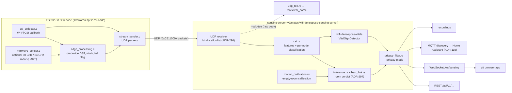

# Architecture

RuView senses people with radio instead of cameras. ESP32 boards capture Wi-Fi
channel state information (CSI), a Rust server turns it into presence, motion
and vital-sign estimates, and those estimates reach a browser, Home Assistant
and other tools.

This page is the map: the main data path from radio to automation, then where
everything else in the repository fits. The details live in the code and in the
[architecture decision records](docs/adr/) (ADRs). When this page and an ADR or
the code disagree, the code and the accepted ADR win.

A note on claims: WiFi sensing is not camera-grade. Accuracy and performance
statements in this repository are tagged **MEASURED** (with a reproducer),
**SYNTHETIC** or **CLAIMED**. A diagram here shows where data flows, not how
well any stage works.

## The main data path



### 1. The node: firmware

`firmware/esp32-csi-node/` is ESP-IDF C for the ESP32-S3 (the production
target) and the ESP32-C6 (a research target). See its
[README](firmware/esp32-csi-node/README.md) for boards and flashing.

- **Capture.** `csi_collector.c` registers the Wi-Fi CSI callback. CSI comes
  from ordinary traffic between the node and the access point, so the node
  needs no special transmitter.
- **Edge processing.** `edge_processing.c` runs a DSP pipeline on the second
  core. Its tier sets how much it does: tier 0 passes raw CSI through, tier 1
  adds basic DSP, and tier 2 adds breathing, heart-rate, presence and fall
  estimates, sent as vitals and feature packets.
- **Optional radar.** `mmwave_sensor.c` auto-detects a 60 GHz (MR60BHA2) or
  24 GHz (LD2410) module on a UART. Its readings travel in the fused vitals
  packet (ADR-063) as a reference.
- **Transport.** `stream_sender.c` sends UDP datagrams. Each packet type
  starts with a magic number: `0xC5110001` raw CSI, `0xC5110002` vitals,
  `0xC5110003` features, `0xC5110004` fused vitals (with radar),
  `0xC5110005` compressed frames, `0xC5110007` WASM module output.
- **Programmable edge.** `wasm_runtime.c` runs uploaded WASM sensing modules
  ([ADR-040](docs/adr/ADR-040-wasm-programmable-sensing.md)). Configuration,
  OTA updates, mDNS discovery and USB onboarding live in the other `main/*.c`
  files.

A build or a simulator is not hardware evidence. Validation needs a captured
boot and runtime log from real silicon.

### 2. The server: sensing-server

`v2/crates/wifi-densepose-sensing-server` is the Axum server most deployments
run. `main.rs` holds the runtime; the modules hold the logic.

- **Ingestion.** `udp_receiver_task` binds per `udp_bind.rs`: loopback by
  default, and other senders only through an explicit allowlist
  ([ADR-296](docs/adr/ADR-296-sensor-data-plane-bind-hardening.md)). It
  decodes each packet type. Other CSI sources plug in beside it: simulated
  data, Windows Wi-Fi scanning (`wifi-densepose-wifiscan`), MediaTek,
  Qualcomm, Realtek and vendor adapters.
- **Features and per-node classification.** `csi.rs` keeps a sliding window
  per node, extracts features (variance, motion-band power, spectral power
  and so on) and classifies each node as absent, present and still, or
  present and moving.
- **Room verdict.** `inference.rs` keeps per-node inference apart from the
  fused room belief
  ([ADR-297](docs/adr/ADR-297-multi-node-semantic-correctness.md)).
  `best_link.rs` makes the room verdict follow the single link that reacts
  most to activity, re-ranked on a schedule, because a link only senses
  movement that crosses its path. `motion_calibration.rs` records a minute
  of empty room and puts each node's presence threshold above what it saw.
- **Vital signs.** Breathing and heart rate come from `VitalSignDetector` in
  the `wifi-densepose-vitals` crate (`detector.rs`). The server publishes
  them only after calibration, with one occupant and a passing quality gate.
- **Outputs.**
  - REST under `/api/v1/` and the `/ws/sensing` WebSocket feed the browser
    app in `ui/`.
  - The `mqtt` module publishes Home Assistant discovery and state. The
    `semantic` module adds inferred states such as `someone_sleeping`
    ([ADR-115](docs/adr/ADR-115-home-assistant-integration.md)).
  - `recording.rs` writes recordings, and `udp_tee.rs` copies admitted
    datagrams unchanged for offline study (`tools/real_home`).
  - The Matter bridge (`matter`) is designed, but the binary doesn't start it
    yet.
- **Privacy.** `--privacy-mode` sends every output through
  `privacy_filter.rs`. It removes heart rate, breathing rate and pose
  keypoints from REST, WebSocket, recordings and MQTT, and the signal field
  stops drawing its breathing ring.

The [sensing-server domain model](docs/ddd/sensing-server-domain-model.md)
describes the bounded contexts in more detail.

### 3. The consumers

- **Browser:** `ui/` is served by the sensing server (`--ui-path`).
- **Home Assistant:** MQTT auto-discovery, blueprints in
  `examples/ha-blueprints`, and the guide in
  [docs/integrations/home-assistant.md](docs/integrations/home-assistant.md).
  Alexa reaches RuView through Home Assistant until the Matter bridge runs.
- **Agents and scripts:** the `@ruvnet/ruview` CLI and MCP server in
  `harness/ruview` read live nodes, radar kits and the server
  ([ADR-283](docs/adr/ADR-283-ruview-community-metaharness-flywheel.md)).

## The rest of the repository

| Area | Path | What it is |
|---|---|---|
| Signal and vitals libraries | `v2/crates/wifi-densepose-{core,signal,vitals,hardware,wifiscan}` | Shared types, CSI processing, the vital-sign estimators (`classic` ADR-021 pipeline and the `detector`), hardware and Wi-Fi scan adapters |
| Portable kernel | `v2/crates/ruview-kernel`, `ruview-kernel-napi`, `harness/ruview-kernel` | A bounded JSON ABI over the vitals pipeline for WASM, Node and npm ([ADR-368](docs/adr/ADR-368-ruview-kernel-wasm-napi-npm.md)) |
| Python bindings | `python/` | The `wifi-densepose` package: PyO3 bindings (`wifi_densepose._native`) over the Rust crates, including the vitals estimators |
| Pose and learning | `v2/crates/wifi-densepose-{nn,train,aether,calibration,physics}`, `cog-*` | Neural inference, training pipelines, per-room calibration and packaged Cognitum "cogs". Pose results need a mean-pose baseline and a leakage-free held-out split. |
| Research crates | `v2/crates/ruview-*`, `wifi-densepose-{sar,bfld,pointcloud,occworld-candle,privshield}`, `nvsim*` | Spatial world models, evidence and scoring, BFI sensing, RF tomography, simulators. Each crate's ADR states its maturity. |
| HOMECORE | `v2/crates/homecore*`, `harness/homecore` | A Rust port of Home Assistant's core, API, automations, recorder, plugins and HomeKit, with its own developer harness ([ADR-285](docs/adr/ADR-285-homecore-wasm-first-metaharness.md)) |
| Desktop | `v2/crates/wifi-densepose-desktop` | Tauri desktop app |
| Python reference | `archive/v1/` | The original Python pipeline. `archive/v1/data/proof/verify.py` is the deterministic proof that must print `VERDICT: PASS`. |
| Research tooling | `tools/bfi`, `tools/bfi_learning`, `tools/real_home` | BFI capture and decoding, the public-data BFI benchmark ([ADR-365](docs/adr/ADR-365-public-bfi-dataset-and-decoder-contract.md)), and the real-home and fall study recorders and scorers |
| Decisions and validation | `docs/adr/`, `docs/validation/`, `docs/ddd/` | Why things are the way they are, how claims are measured, and the domain models |
| CI | `.github/workflows/` | The authoritative gates. Branch protection requires the CSI data-policy check ([ADR-299](docs/adr/ADR-299-csi-data-incident-repo-controls.md)) and the fix-marker check. |

## Rules that shape the design

- **No CSI or person data in Git.** Raw CSI is person data. CI fails on
  tracked capture files (ADR-299), and the study recorders refuse to write
  inside a Git work tree.
- **Least authority at every boundary.** Network, UDP, file, FFI and MCP
  inputs are validated, and binds default to loopback.
- **Default-off for unvalidated outputs.** Heart rate and fall detection are
  not published to Home Assistant unless explicitly enabled, because neither
  has been validated.
- **Evidence over assertion.** See the note at the top, and
  [CLAUDE.md](CLAUDE.md) for the full contributor rules.

## Building and testing

The validation matrix in [CLAUDE.md](CLAUDE.md) lists the commands for each
area. The Rust workspace builds and tests from `v2/`:

```bash
cd v2
cargo test -p wifi-densepose-sensing-server
cargo test --workspace --no-default-features
```
